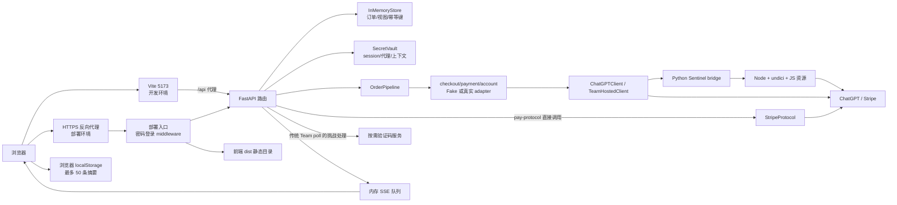
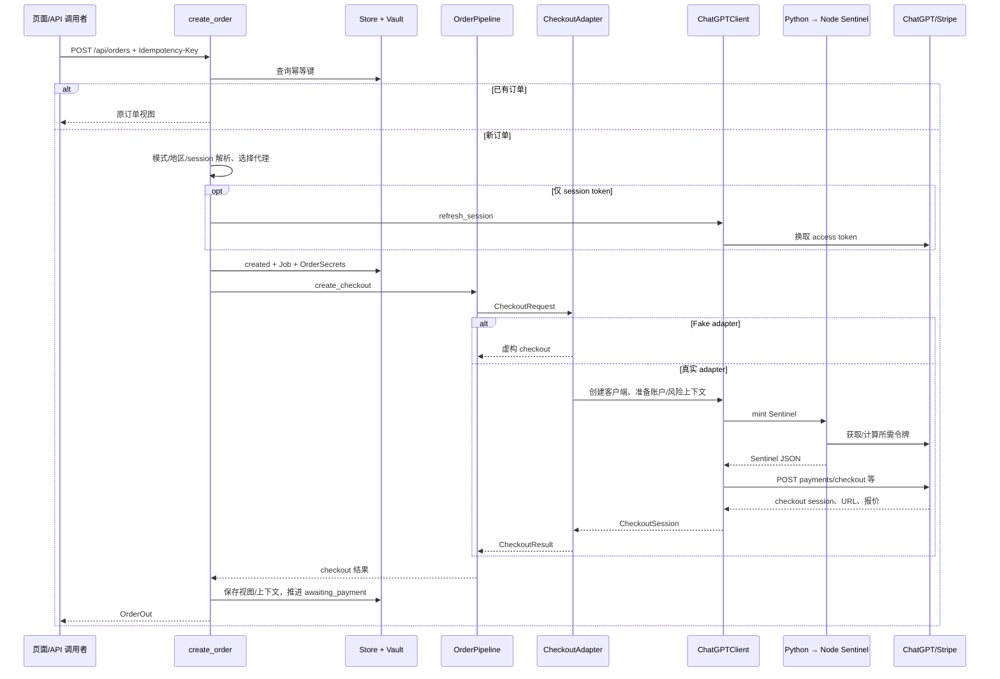
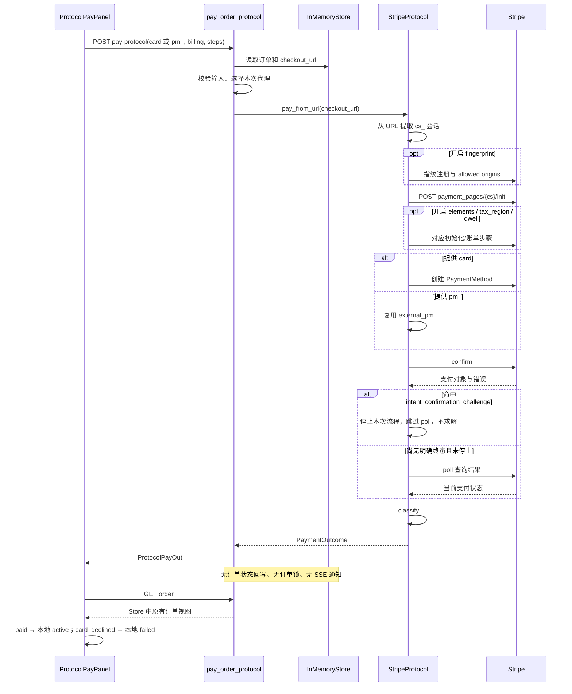
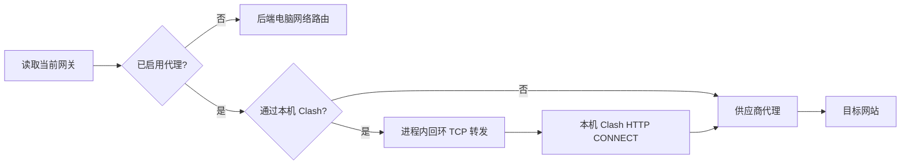

# 调用流程文档

本文以 2026-10-21 当前源码为准，说明从页面建单到支付结果的实际调用链。Windows 开发环境第一次安装启动、第二次及以后启动的完整命令见 [启动命令文档](启动命令文档.md)。源码链接使用仓库相对路径，进入文件后可按本文给出的函数或类名定位。

当前最容易混淆的是：页面默认调用 `/pay-protocol`，而完整订单状态机主要由 `/pay`、`/verify`、Team poll 路线维护。protocol 返回的支付结果不会自动写回订单，页面会自行把部分结果映射为本地状态。因此，页面结果、API Store 状态和真实订阅状态并非始终一致。

## 1. 技术栈与模块职责

| 层 | 当前实现 | 主要职责与源码入口 |
| --- | --- | --- |
| 页面 | React 19、TypeScript、Vite 6、Mantine 9，版本范围见 package.json | [OrderNew.tsx](../apps/web/src/pages/OrderNew.tsx) 组织表单与支付页面；[ProtocolPayPanel.tsx](../apps/web/src/components/ProtocolPayPanel.tsx) 组织当前默认支付输入。 |
| 前端 API | fetch、EventSource、localStorage | [client.ts](../apps/web/src/api/client.ts) 封装请求；[events.ts](../apps/web/src/api/events.ts) 订阅 SSE；[history.ts](../apps/web/src/api/history.ts) 记录浏览器历史。 |
| HTTP API | FastAPI、Pydantic、Uvicorn | [main.py](../services/api/src/gss_api/main.py) 注册路由；[schemas.py](../services/api/src/gss_api/schemas.py) 定义请求/响应结构；[orders.py](../services/api/src/gss_api/routers/orders.py) 执行业务编排和部分直接上游调用。 |
| 合约与状态机 | Python dataclass/Enum、显式状态迁移 | [models.py](../packages/contracts/src/gss_contracts/models.py)、[state.py](../packages/contracts/src/gss_contracts/state.py)、[adapter.py](../packages/contracts/src/gss_contracts/adapter.py) 定义订单、模式、adapter 接口。 |
| 订单 Store | 进程内字典 | [store.py](../services/api/src/gss_api/store.py) 的 `InMemoryStore` 存订单、视图、Job 和幂等键。 |
| 凭证暂存 | 内存 Vault | [vault.py](../packages/core/src/gss_core/vault.py) 的 `OrderSecrets`、`SecretVault` 暂存 session、代理和支付上下文。 |
| 流水线 | 无内部订单状态的 Python 编排 | [pipeline.py](../services/orchestrator/src/gss_orchestrator/pipeline.py) 的 `OrderPipeline` 调 checkout/payment/account adapter。 |
| adapter | Fake 或真实实现 | [runtime.py](../services/api/src/gss_api/runtime.py) 的 `build_pipeline` 选择实现；[checkout](../services/checkout/src/gss_checkout/adapter.py)、[payment](../services/payment/src/gss_payment/adapter.py)、[account](../services/account/src/gss_account/adapter.py) 各司其职。 |
| ChatGPT/Stripe 客户端 | curl_cffi、httpx，部分同步调用在线程中执行 | [chatgpt.py](../packages/core/src/gss_core/chatgpt.py)、[hosted.py](../packages/core/src/gss_core/hosted.py)、[stripe_protocol.py](../packages/core/src/gss_core/stripe_protocol.py) 处理不同 checkout 形态。 |
| 风控令牌桥接 | Python subprocess → Node.js + undici | [sentinel.py](../packages/core/src/gss_core/sentinel.py) 与 [sentinel_bridge.js](../packages/core/src/gss_core/sentinel_assets/sentinel_bridge.js) 执行 Sentinel JS 资源。 |
| 部署 | 单 API 容器、静态文件、外部 HTTPS 反代 | [app.py](../deploy/server/app.py)、[Dockerfile](../deploy/docker/Dockerfile)、[Compose](../deploy/docker/docker-compose.yml)。 |

本表版本来自 [package.json](../apps/web/package.json) 和 [requirements.txt](../deploy/server/requirements.txt)，不是“最新版本”声明。Python DB/worker 模块虽然存在，当前在线 API 的调用入口并不使用 SQLite repository。

## 2. 架构与运行入口

### 2.1 开发入口

`python -m uvicorn gss_api.main:app --host 127.0.0.1 --port 8080` 导入 [main.py](../services/api/src/gss_api/main.py) 中 `app = create_app()`。`create_app` 安装日志脱敏过滤器、加载配置、注册 orders/promo/events/proxies 路由、创建 `GatewayStore`，并提供 `/api/health`。

开发入口不挂载前端静态目录，也没有密码登录 middleware。[Vite 配置](../apps/web/vite.config.ts) 负责在 5173 提供页面并将 `/api` 代理到 8080，浏览器因此通过同一个前端 origin 请求 API。

### 2.2 部署入口

[deploy/server/app.py](../deploy/server/app.py) 导入同一个 `create_app()`，额外注册 `TestAccessMiddleware`，最后在 `/` 挂载 `StaticFiles(directory=GSS_WEB_DIR, html=True)`。镜像将该文件复制为 `/app/app.py`，启动 `uvicorn app:app`。

`TestAccessMiddleware` 从 `GSS_AUTH_FILE` 读取 `{"password":"..."}`，提供 `/login`、`/logout` 和签名 cookie。cookie 为 `__Host-gss_session`，有效期 12 小时，带 Secure、HttpOnly、SameSite=Strict。写请求若携带 Origin，会按 `GSS_PUBLIC_ORIGIN` 或请求 Host 校验。未登录的页面访问跳转 `/login`，未登录 `/api/*` 返回 401，**包括 `/api/health`**。详细逻辑见 [test_access.py](../services/api/src/gss_api/test_access.py) 的 `dispatch`。

Docker 只有 API 服务；前端要在宿主源码中先运行 `npm ci`、`npm run build`，Dockerfile 只复制 dist。根路径 303 和 Docker 健康检查证明入口能响应，不证明上游支付服务可用。部署时需使用 HTTPS；Compose 的 `/config` 为只读，若需要网页保存代理，可设置 `GSS_PROXY_CONFIG=/data/proxy-gateways.json`。

## 3. 数据与状态的实际边界

### 3.1 Store 和 Vault 是两类内存状态

[orders.py](../services/api/src/gss_api/routers/orders.py) 直接导入 `from ..store import store`；[store.py](../services/api/src/gss_api/store.py) 最后实例化 `store = InMemoryStore()`。`Order` 主要保存业务状态，`OrderView` 保存 checkout URL、公钥、金额、币种、账单、错误和 next_action 等用于响应的字段。

Vault 另存原始 session、checkout session ID、公钥、代理、账单和 Team context。`OrderSecrets.expires_at` 默认在创建时设置为约 30 分钟后；`put/get` 会清理到期项，但对同一个对象再次 `put` 并不自动延长其原有到期时间。订单仍在 Store 不代表 Vault 凭证仍有效。交付路径调用 `vault.drop(order_id)` 主动删除凭证。

进程重启会同时丢失订单、幂等键、凭证和 SSE 订阅。多个 Uvicorn worker 会各自持有一套状态，无法可靠共享订单。因此当前应保持单 worker，不能通过“开多个 workers”直接扩容。

### 3.2 SQLite/worker 代码不是在线队列

[db.py](../services/api/src/gss_api/db.py)、[repository.py](../services/api/src/gss_api/repository.py) 和 [worker.py](../services/orchestrator/src/gss_orchestrator/worker.py) 存在独立数据库/worker 实现，worker 仍使用 `temp-session-placeholder`、`temp-token-placeholder`，并以 TODO 标注从安全临时存储或客户端获取。在线建单却只把 `Job` 加入 `InMemoryStore`，没有写入 SQLite repository，也没有向 worker 接通真实凭证的投递链路。

因此当前请求内由 `OrderPipeline` 执行 checkout/pay；启动 worker 不会自动处理这些在线订单，不能宣称现状具备持久队列、数据库断点续跑或重启恢复。`GSS_DATA_DIR/app.db` 这样的配置字段与旧 ADR 只是相关代码/设计背景，不等于在线接口已经接通数据库。

### 3.3 三种“状态”要分开看

| 状态来源 | 例子 | 含义 |
| --- | --- | --- |
| 服务端订单状态 | `awaiting_payment`、`paying`、`verifying`、`active`、`delivered` | Store 的业务状态机。 |
| adapter 支付结果 | `succeeded`、`requires_action`、`declined`、`processing` | `/pay` 用来推进订单状态的 `PaymentStatus`。 |
| protocol 支付结果 | `paid`、`card_declined`、`confirm_error`、`unknown` | `/pay-protocol` 的 `PaymentOutcome.state`；不会自动变成 Store 状态。 |

不要把 Stripe intent 中的 `succeeded` 当作 protocol API 返回的 `state` 字段值。protocol 的成功值是 `paid`。

## 4. 建单调用链

### 4.1 前端发起

[OrderNew.tsx](../apps/web/src/pages/OrderNew.tsx) 收集套餐、地区、session、Team 席位/工作区及促销信息，通过 [client.ts](../apps/web/src/api/client.ts) 请求 `POST /api/orders`。请求结构是 [schemas.py](../services/api/src/gss_api/schemas.py) 的 `OrderCreateRequest`；其 `session` 是字符串，完整 session JSON 也作为这个字符串字段传入。

### 4.2 后端的执行顺序

[orders.py](../services/api/src/gss_api/routers/orders.py) 的 `create_order` 按以下顺序处理：

1. 读取 `Idempotency-Key`，先在当前 Store 查找同键订单，存在即返回原订单。没有实现按请求内容比较同键 payload 的机制，也没有跨进程持久幂等保障。
2. 校验套餐枚举、账号/卡片/账单模式、促销开关 `GSS_ENABLE_PROMO`，要求 customer_session 模式有 session。
3. 调用 `parse_session_bundle` 解析原始输入。具体接受格式、access token、session token、cookie/device 信息处理见 [session_token.py](../packages/core/src/gss_core/session_token.py)。
4. 规范化并检查地区，调用 `session_proxy("checkout", country)`、`configured_proxy("checkout")` 和 `align_proxy_region` 确定本订单出口。代理角色、地区和 SID 处理见 [proxies.py](../packages/core/src/gss_core/proxies.py)。
5. 若只有 session token、没有 access token，直接创建 `ChatGPTClient` 调 `refresh_session` 换取 access token。**此处在 adapter 选择之外，Fake 模式也可能出网。** 无可用 access token 时返回 401。
6. Team 必须提交 `seat_quantity`，经 `clamp_team_seats` 校验，最少 2 人；空工作区名称回填 `Team Workspace`；周期归一为 month/year。
7. 在 Store 创建 `created` 订单与 `stage="checkout"` Job，在 Vault 保存 session 和出口代理。
8. `build_pipeline()` 按 `GSS_USE_FAKE` 组装 adapter，执行 `pipeline.create_checkout(...)`。
9. checkout 失败时将订单标记 `rejected`，记录错误并返回异常；成功时把 URL、公钥、报价、账单、checkout_kind、Team 信息写入视图，将 checkout session 等更新到 Vault。若 adapter 返回 `effective_proxy`，用其替换原保存代理。
10. 状态推进 `created → pending_checkout → awaiting_payment` 并返回 `OrderOut`。如果建单请求同时带 `payment_method_token`，则继续调用 `/pay` 所用的 `pay_order` 逻辑。

### 4.3 adapter 与 ChatGPTClient 的分工

[pipeline.py](../services/orchestrator/src/gss_orchestrator/pipeline.py) 的 `create_checkout` 负责模式校验和构造 `CheckoutRequest`，不自己发 HTTP。[checkout adapter](../services/checkout/src/gss_checkout/adapter.py) 的 `UpstreamCheckoutAdapter.create_checkout` 负责真实客户端调用和出口处理；同步网络流程通过线程执行，避免长时间阻塞事件循环。

真实 Team 建单会先用选定代理探测 Stripe，再尝试创建 checkout；候选包括原 SID 和至多两个新 SID。当前没有无代理直接建单的 Team 候选，未配置可用代理时会返回“订单代理连接Stripe失败，未创建结账/未付款”。有效出口通过 `effective_proxy` 返回路由并保存到 Vault。

[chatgpt.py](../packages/core/src/gss_core/chatgpt.py) 的 `ChatGPTClient` 负责 session/cookie 身份、账户信息、请求头、风险上下文、checkout 请求以及响应解析。`create_checkout` 调用 ChatGPT 的 `/backend-api/payments/checkout`，并解析不同会话标识：

- Team 主线使用 hosted checkout，通常有 Stripe `cs_...` 会话与托管长链。
- Plus 等 custom checkout 可能含内部 `oaics_...`，源码也兼容 Stripe `cs_...` 响应。不能断言 custom 永远只有 oaics。
- 公钥先从 checkout 响应读取，缺失时尝试 `_publishable_key` 请求 `stripe_client_bootstrap`。不能断言 custom 永远没有公钥；hosted 获取公钥失败可以降级纯链接，而 custom 缺公钥会失败。
- `checkout_kind`、实际 URL、会话 ID 和公钥组合决定后续能力，仅看到套餐名不足以确定支付路线可用性。

### 4.4 Sentinel：仍需要 Node，但不需要浏览器

`ChatGPTClient.mint_sentinel` 调用 [sentinel.py](../packages/core/src/gss_core/sentinel.py) 的 `mint`。Python 向子进程 stdin 传 JSON（UA、device、flow、proxy、语言、时区、cookie 等），启动 `SENTINEL_NODE` 或 PATH 中的 `node`，执行 `sentinel_bridge.js`，读取 stdout JSON 并提取令牌。默认子进程超时约 90 秒；无 Node、超时、输出错误或缺少有效 main 数据时会返回空结果，由调用方处理。

桥接资源在 [sentinel_assets](../packages/core/src/gss_core/sentinel_assets/sentinel_bridge.js)，包含 JS SDK、bootstrap 和 Python curl fetch 辅助。Node 需要 `undici` 的 fetch/ProxyAgent 配套实现，Python 通过环境变量把当前解释器提供给桥接。它不是 Chrome 会话，当前部署不需要归档 browser route 的 Xvfb/浏览器容器。

## 5. Team 报价与准备上下文

| 接口 | 行为 | 是否确认支付 |
| --- | --- | --- |
| `POST /api/orders/{id}/team/quote` | 读取当前会话应付金额/币种，可带账单信息；更新 `view.amount/currency/quote_error`。 | 否。 |
| `POST /api/orders/{id}/team/prepare` | 初始化传统 Team 支付上下文，包括 context_id、账单、时间戳、设备/Elements 和验证码上下文。 | 否。 |
| `POST /api/orders/{id}/team/poll` | 查询已存在的支付页面状态，必要时继续处理已保存的 challenge。 | 不是重新提交卡片确认，但可能继续验证流程。 |

三者的路由和 `_team_client`、`_team_quote` 在 [orders.py](../services/api/src/gss_api/routers/orders.py)，真实实现位于 [TeamHostedClient](../packages/core/src/gss_core/hosted.py)。quote/prepare 使用订单锁，检查 Team 套餐、订单仍处于 `awaiting_payment`、Vault 未过期；Fake quote 直接返回当前视图，Fake prepare 生成 fixture context。

quote 失败主要记录为 `quote_error`，不会仅因报价失败就把订单标记为付款失败。金额按币种的小数规则从 minor units 转换，不能把所有币种都无条件除以 100。网页“刷新应付金额”调用这一接口；报价成功不代表支付已提交。

prepare 将内部完整 context 存入 Vault，仅向前端返回所需子集。真实 Team `/pay` 要求请求中的 `team_context_id` 与保存值匹配，context 不超过 600 秒，账单与准备时一致；变更账单后需要重新 prepare。传统路线与当前默认 protocol 路线不共享同一套 prepare 前提。

## 6. 两条支付路线不能混为一谈

### 6.1 对照表

| 维度 | `/api/orders/{id}/pay` | `/api/orders/{id}/pay-protocol` |
| --- | --- | --- |
| 核心调用 | `OrderPipeline.pay` → PaymentAdapter | 直接 `StripeProtocol.pay_from_url` |
| Fake 开关 | 使用 FakePaymentAdapter | 不受 `build_pipeline` 的 Fake 选择保护，仍会直接真实调用 |
| 请求支付源 | `payment_method_token`；真实 Team 还支持 card 在服务端先 token 化 | `card` 或 `payment_method_id` 二选一，另有 billing、proxy、steps |
| 并发与状态检查 | 订单级锁；主要只接受 awaiting_payment，已交付可返回现状 | 无订单锁；拒绝已 active/delivered，但没有相同的 paying 状态推进保护 |
| 凭证/代理 | 读取 Vault，沿用保存出口并按账单地区调整 | 从 payload.proxy 或配置的 checkout 代理选取，不沿用 Vault 保存出口 |
| 状态回写 | 更新 Store、错误、next_action 和订阅信息 | 不更新 Store、Vault 或业务状态 |
| SSE | 在部分状态变化发送通知 | 不发送订单更新通知 |
| 响应 | `OrderOut` | `ProtocolPayOut`，含 state/code/decline_code 等 |
| 支付成功值 | adapter 的 succeeded 后推进订单 | `state="paid"` |

具体依据：[orders.py](../services/api/src/gss_api/routers/orders.py) 的 `pay_order`、`_pay_order`、`pay_order_protocol`，以及 [runtime.py](../services/api/src/gss_api/runtime.py)。

### 6.2 `/pay`：订单状态机路线

`pay_order` 在 `_team_locks[order_id]` 下执行 `_pay_order`。确认订单存在；active/delivered 直接返回；其他非 awaiting_payment 状态通常返回 409，避免重复确认；Vault 失效返回 401。

真实 Team 先校验 prepare context。若请求带 card，就用 `TeamHostedClient.tokenize` 在服务端获得 pm_，随后进入同一 pipeline；card 与 `payment_method_token` 不能同时提供。账单检查允许 Team 的付款账单国家与创建 checkout 的地区独立，其他套餐要求账单国家与订单地区一致。

随后更新为 `paying`，调用 `pipeline.pay`，由 [UpstreamPaymentAdapter](../services/payment/src/gss_payment/adapter.py) 根据 Team hosted、ChatGPT 内部 checkout、Stripe custom 等情况选择确认链路。`next_action` 用于返回 3DS/challenge；不能将所有 declined 都解释成发卡行拒卡，ChatGPT blocked 也可能被映射为该类业务结果，应查看原始错误摘要。

Team 分支调用 `_pay_team` → `TeamHostedClient.confirm`，使用已准备的 hosted context。非 Team 分支先通过 `_confirmation_token` 使用现有 `ctoken_`，或把 `pm_` 换成 confirmation token；随后调用 `ChatGPTClient.confirm_checkout`。内部 `oaics_` 路线请求 ChatGPT `/backend-api/payments/checkout/confirm`，Stripe custom `cs_` 路线走对应的 custom 确认/收尾逻辑。适配器解析返回的 PaymentIntent，按其状态查询或确认 intent，再转换为 `PaymentResult`。因此，后端已经有 pm_ → ctoken_ 能力，不应把浏览器产出 ctoken_ 说成唯一可能的输入来源。

[pipeline.py](../services/orchestrator/src/gss_orchestrator/pipeline.py) 的 `PAYMENT_STATUS_TO_ORDER` 将 succeeded 映射为 verifying、requires_action 映射为 requires_action、declined 映射为 failed、error 映射为 unknown。路由随后继续处理成功结果：

- Team 进入 verifying 后直接调用 `_mark_delivered`。
- 非 Team 成功后会尝试 `pipeline.verify` 填写订阅附带信息，但捕获的订阅查询 `DomainError` 或尚未生效结果不阻止交付，之后仍调用 `_mark_delivered`。
- `_mark_delivered` 推进 `verifying → active → delivered`，清空错误/next_action、删除 Vault 凭证并通知 SSE。

因此，当前 `/pay` 的业务规则是“支付成功即可交付”，不能沿用旧注释或早期设计声称每次交付都强制以 `subscription.active=true` 为门槛。独立 `/verify` 仍有自己的分支规则。

### 6.3 `/pay-protocol`：独立协议客户端路线

`pay_order_protocol` 读取订单 checkout_url，检查 `card` 与 `payment_method_id` 恰好提供其一；pm_ 要通过前缀校验。它读取验证码设置，以请求代理优先，否则取配置的 checkout 代理并对齐账单国家，然后直接在线程中实例化 `StripeProtocol`，没有经过 adapter 选择。

[stripe_protocol.py](../packages/core/src/gss_core/stripe_protocol.py) 的 `pay_from_url` 要从 URL 提取 `cs_live_...` 或 `cs_test_...`。只有内部 oaics 的 URL 无法通过此步骤。协议内部主要执行 init、按选项执行设备/Elements/地址环节、复用或创建 PaymentMethod、confirm 和必要的 poll。

当前纯协议路径不生成 passive captcha token。confirm 命中 `intent_confirmation_challenge` 时，代码设置 abandoned，停止本次流程并跳过轮询；不会启动浏览器或调用验证码求解服务。虽然路由读取了 captcha 配置、类中也保留验证辅助方法，不能据此说当前主路径会自动解决挑战。额外验证后的完整支付结果未在本次工作中验证。

**Stripe payment page init 实际为 POST**：`init_checkout` 通过 `_post` 请求 `/v1/payment_pages/{cs_id}/init`，不是 GET。`ProtocolStepsIn` 的 fingerprint、dwell、elements、tax_region 默认均为 false，不能把示意流程图中的每个可选环节都说成每次必定执行。

`classify` 当前可能给出如下 state；应用应同时读取 code、decline_code、message 和 intent_status，而不是只判断 HTTP 200：

| protocol state | 当前分类含义 |
| --- | --- |
| `paid` | intent 为 succeeded/requires_capture，或 poll 判定 succeeded；这是客户端分类，不能自动等同订阅已生效。 |
| `confirm_error` | confirm 参数/会话类错误，例如 checkout_confirm_error 或 HTTP 400，不应直接解释成发卡行拒卡。 |
| `card_declined` | 错误码/拒绝码或失败轮询等被归入此类，需结合详情。 |
| `captcha_rejected` | 错误信息包含验证码相关拒绝。 |
| `challenge_required` | intent 仍要求操作。 |
| `unknown` | 未能确定上述终态。 |

路由只返回结果，不回写状态、不删除 Vault、不发送 SSE。前端 [OrderNew.tsx](../apps/web/src/pages/OrderNew.tsx) 的 `onDone` 虽然再 GET 一次订单，但之后对 paid/card_declined 调用 `finish` 时使用的是本地覆盖的 active/failed。于是历史记录可以显示成功，而 GET order 仍是 awaiting_payment。这是当前实现边界，不是数据库同步延迟。

前端 `payProtocol` 给请求 300000 ms 超时；超时不代表服务端已取消。当前没有可靠的 protocol 结果回写/异步恢复通道，不能仅靠 SSE 或原订单查询断定本次协议支付没发生，更不能据此自动重复提交。

### 6.4 页面默认路线与 card 数据边界

[OrderNew.tsx](../apps/web/src/pages/OrderNew.tsx) 当前把 `payMode` 固定为 `"protocol"`。当前 `ProtocolPayPanel` 提交的是 card 入参；后端协议接口及前端 API 类型另支持 `payment_method_id`，但这不表示当前面板已提供混合模式切换。前端仍保留一些传统支付和 Stripe 交互代码，不代表页面当前会自动切换到这些路径。

Plus custom 的返回形态和 protocol 需要的 `cs_` URL、可用公钥及后续确认路径并非总能匹配，不能称其端到端已经完整支持；但源码确有 cs_ 兼容、bootstrap 公钥和 custom 确认分支，也不能反过来断言“Plus 永远是 oaics、永远没有 pk”。应按当前建单响应与具体客户端分支判断。

旧 UI/注释里“卡号不经本站”不适用于所有现有路线：`ProtocolPayRequest.card` 和真实 Team `OrderPayRequest.card` 都会把卡片数据发送到本站服务端，再由服务端交给 Stripe。请求 schema 及实现意图是临时使用、不落订单库，不能据旧文案声称后端从未接触卡号。只提交浏览器已取得的 pm_ 时，该请求才无需携带原始 card 字段。

## 7. 查询、verify、Team poll 与 SSE

### 7.1 GET order

`GET /api/orders/{id}` 仅返回 Store 当前视图，不主动查询 Stripe 或 ChatGPT，不会修复 protocol 未回写的状态。找不到订单返回 404；这也可能发生在进程重启后。

### 7.2 verify

`POST /api/orders/{id}/verify` 对真实 Team 转入 `poll_team`。其他情况读取 Vault、推进可恢复状态到 verifying，再调用 `pipeline.verify` 查询订阅：

- `info.active=true` 时转 active，执行 `assert_deliverable`，转 delivered，删除 Vault 并发送 SSE。
- session 无效或过期直接报错；其他订阅查询错误一般保留当前状态并返回可重试的错误信息。
- `?paid=true` 是另一分支：订阅暂未生效或非 session 类查询异常时也可 `_mark_delivered`。它不是新的 Stripe 扣款验证操作，不能把这个参数当作服务端已独立确认支付的证据。

函数定位：[orders.py](../services/api/src/gss_api/routers/orders.py) 的 `verify_order`；账号查询实现见 [account adapter](../services/account/src/gss_account/adapter.py) 和 [ChatGPTClient.subscription_payload](../packages/core/src/gss_core/chatgpt.py)。

### 7.3 Team poll

`POST /api/orders/{id}/team/poll` 使用订单锁和保存的 Team checkout 上下文调用 `TeamHostedClient.poll`。若已有 `intent_confirmation_challenge` 且结果未终结，可在轮询期间执行较耗时的挑战处理。成功推进到 delivered；declined 转 failed；requires_action 保留相应 next_action。pending 响应不能擦掉先前保存的 challenge/client_secret。

poll 是传统 Team 状态维护的一部分；不要把它视为覆盖所有 Plus custom 和 protocol 结果的通用恢复接口。相关符号为 `poll_team`、`_solve_challenge` 和 `hosted_payment_result`。

### 7.4 SSE

正确地址为 **`GET /api/events/orders/{id}/stream`**，不是 `/api/orders/{id}/events` 等旧地址。[events.py](../services/api/src/gss_api/routers/events.py) 为每个订单维护内存订阅队列，发送初始 `type: init`，随后发送包含 order_id/status/timestamp 等字段的数据，空闲约 60 秒发 heartbeat。

前端 [events.ts](../apps/web/src/api/events.ts) 的 `subscribeOrderUpdates` 使用 `EventSource`，忽略 init，收到普通 message 时调用回调；浏览器可自动重连，返回函数用于关闭连接。队列容量 32，慢消费者可能被移出订阅；没有持久事件日志或断点重放机制。

订单不存在时接口返回含错误数据后结束的事件流，并非标准订单 GET 的 404 行为。通知只在路由显式调用 `notify_order_update` 时产生，不能假设每次 Store 更新都自动广播，尤其 `/pay-protocol` 完全不发送订单更新。

## 8. 浏览器历史与页面展示

[history.ts](../apps/web/src/api/history.ts) 用 localStorage 键 `gss.history.v1` 保存记录，并兼容读取旧键 `dcp.history.v1`。`recordOrder` 按订单 ID 去重，将最新记录放前面并截取最多 50 条；记录包含 ID、套餐、地区、金额、币种、状态、错误摘要和时间。

历史是当前浏览器/当前 origin 的摘要，不是后端订单库。换浏览器、换域名、清理站点数据会影响可见记录；localStorage 不可写时不能保证持久保存。它也不保存恢复支付所需的 Vault session/context。

因为 protocol 的 paid/card_declined 在页面里本地映射为 active/failed，历史展示可能包含这种本地状态。排查问题应同时区分：页面显示、GET order 返回、protocol 响应、实际账单/订阅，而不能只凭浏览器历史判断服务端已经完成交付状态迁移。

## 9. 配置与排查入口索引

### 可选的本机 Clash 中转

[代理设置页面](../apps/web/src/components/ProxySettings.tsx) 在保存的网关配置中增加 `use_clash`（旧配置默认 `false`）和 `clash_proxy_url`（默认 `http://127.0.0.1:7897`）。填写新的 `raw` 会替换旧凭证并默认关闭中转；省略 `raw` 可仅更新开关并保留凭证。页面保存通过一次原子文件替换同时更新 checkout、approve。

[Gateway.effective_proxy_url](../packages/core/src/gss_core/proxies.py) 为开启中转的配置生成运行时回环地址；[RelayManager](../packages/core/src/gss_core/proxy_relay.py) 使用独立事件循环转发字节，凭证、地区和 SID 仍交给供应商处理。HTTPS 网关在转发层按真实主机名进行 TLS 和证书验证。原始配置不保存临时端口，服务关闭时释放监听与连接；旧转发在本进程内保留，配置变更不把已建立的连接改道。

`configured_proxy`、建单派生代理以及沿用这些地址的 Sentinel、查询和支付共用此链路。显式请求代理覆盖仍优先；`/pay-protocol` 原有的重新读取配置行为不变，不能将“已建立连接不改道”理解为“所有旧订单永远使用旧配置”。Clash 连接失败或已保存配置损坏不会回退直连。

`POST /api/settings/proxies/{role}/test` 使用同一有效配置，停用或未配置时也可运行，返回 `mode`（`direct` / `proxy` / `clash`）、`ip`、`elapsed_ms`。它只访问出口测试网站，不查询优惠或执行支付。页面将账号目标地区、账单国家与实测出口区分，不根据 `US` 账单值推断网络所在地。Python HTTP 客户端禁用环境代理；curl 客户端同时显式设置 libcurl 选项，避免 `trust_env=False` 仍读取代理环境变量。

### 源码索引

| 要排查的事项 | 源码与定位符号 |
| --- | --- |
| 环境变量、Fake/促销开关 | [config.py](../packages/core/src/gss_core/config.py)：`load_settings`、`use_fake_adapters`；促销是 `GSS_ENABLE_PROMO`。 |
| 建单幂等、两条支付入口、Team/verify | [orders.py](../services/api/src/gss_api/routers/orders.py)：`create_order`、`_pay_order`、`pay_order_protocol`、`quote_team`、`prepare_team`、`poll_team`、`verify_order`。 |
| 代理持久文件、地区/SID | [proxies.py](../packages/core/src/gss_core/proxies.py)：`proxy_config_path`、`GatewayStore`、`session_proxy`、`align_proxy_region`。 |
| Session 格式与 JWT 邮箱提取 | [session_token.py](../packages/core/src/gss_core/session_token.py)：`parse_session_bundle`、`parse_session`、`email_from_access_token`。 |
| 非持久订单与约 30 分钟凭证 | [store.py](../services/api/src/gss_api/store.py)：`InMemoryStore`；[vault.py](../packages/core/src/gss_core/vault.py)：`OrderSecrets`、`SecretVault`。 |
| 真实 checkout 类型与公钥 | [chatgpt.py](../packages/core/src/gss_core/chatgpt.py)：`create_checkout`、`_publishable_key`、`confirm_checkout`、`confirm_stripe_custom_checkout`。 |
| protocol init/分类 | [stripe_protocol.py](../packages/core/src/gss_core/stripe_protocol.py)：`init_checkout`、`pay_from_url`、`pay`、`classify`。 |
| 日志脱敏 | [redaction.py](../packages/core/src/gss_core/redaction.py)：脱敏实现；同时注意直接上游调用路径的实际日志内容。 |
| 部署登录、静态目录 | [app.py](../deploy/server/app.py)、[test_access.py](../services/api/src/gss_api/test_access.py)：`TestAccessMiddleware`。 |

前序源码分析在 2026-10-21 已完成 69 个 Python 文件 AST 解析，并运行 `python -m pytest tests/contract tests/unit/test_pipeline.py tests/unit/test_protocol_payment_source.py tests/integration/test_orders_api.py -p no:cacheprovider`，记录为 `46 passed in 0.77s`。这是限定的前序离线检查，不是本轮文档编写重新测试，也不是前端构建、Docker 部署或真实支付成功证明。开发启动命令见 [启动命令文档](启动命令文档.md)；若单独复现上述测试，还需安装 pytest 及其测试依赖。

2026-10-23 的 Clash 开关实现验证记录（后续按要求删除了本次新增的临时测试文件和测试方法，以下为删除前的结果）：代理专项 43 项通过；扩大离线检查（排除缺少 SQLAlchemy 的数据库测试）为 246 项通过、3 项失败。三项失败用 Git HEAD 中原有的验证码、托管协议与应用入口源码也可复现，分别是验证码字段断言和两项日志捕获断言。前端 TypeScript 检查与 Vite 构建通过；浏览器已验证开关保存、刷新恢复、新代理重置开关，以及真实出口连接测试。Python curl_cffi 和 Node undici 经本机 Clash、供应商代理访问出口测试网站均返回 HTTP 200。未验证真实优惠资格、支付或 Docker 构建；代理测试通过不能作为支付成功的依据。
