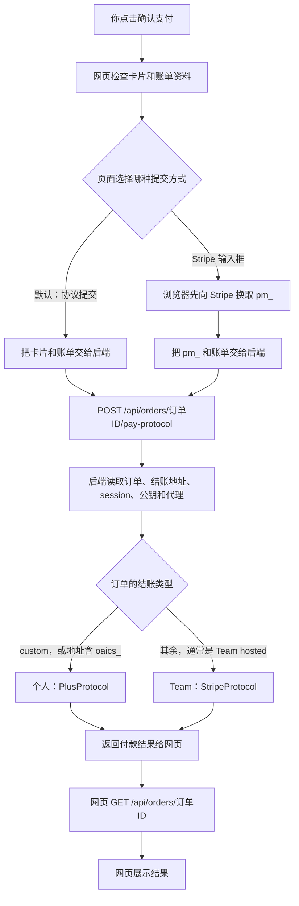
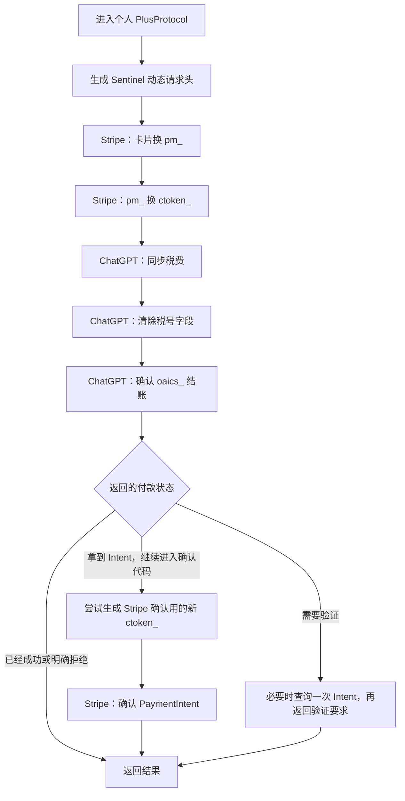
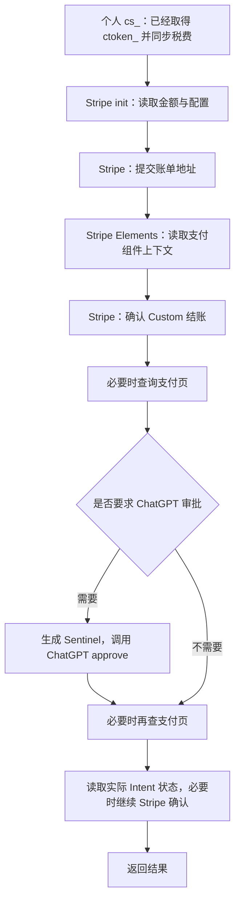
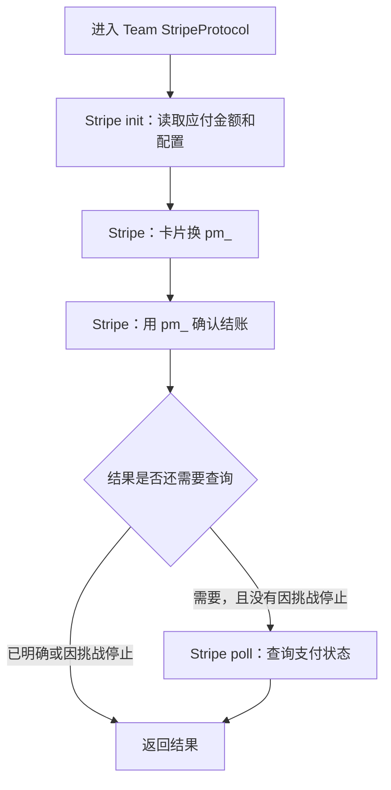
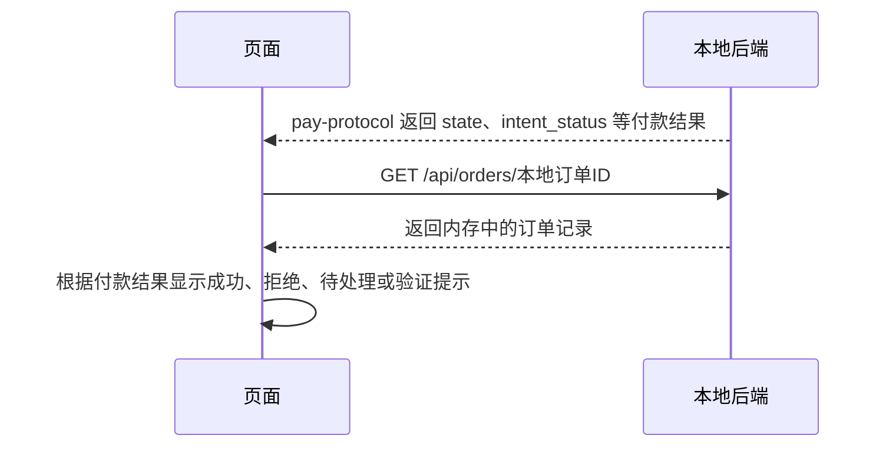

# 页面点击“确认支付”后，调用了哪些接口？

按本地更新后的 `6b64475` 源码核对。下面从**已经创建好订单，点击付款按钮**开始，不重新创建结账，不查询优惠资格。

**现在支持自动分流：个人进入 PlusProtocol，Team 进入 StripeProtocol。个人 oaics_ 不会再被直接交给只认 cs_ 的 Team 流程。**

## 一、先看总图

- 默认“协议提交”：后端把卡片换成 `pm_`。选择“Stripe 输入框”时，这一步由浏览器先完成，后端复用 `pm_`，不再重复提交卡片。
- 两种方式都调用同一个本地 `/pay-protocol`。`pm_` 是卡片对应的支付方式编号，不是订单号。
- 开发时网页请求先到 `127.0.0.1:5173/api/...`，Vite 转给 `127.0.0.1:8080/api/...`。
- 后端实际判断条件是 `checkout_kind=custom`，或者结账地址含 `oaics_`；不只看单号是否以 `cs_` 开头。

## 二、个人结账返回 oaics_，怎么走？

下面按默认“协议提交”画。图里的请求由后端自动发送，不需要你手动逐条调用。

| 顺序 | 调用的第三方接口 | 这一步干什么 |
| --- | --- | --- |
| 1 | Node SDK 内部请求 `https://chatgpt.com/backend-api/sentinel/req` | 生成 Sentinel 请求头；准备过程中可能重复生成 |
| 2 | `POST https://api.stripe.com/v1/payment_methods` | 卡片、账单 → 返回 `pm_`；Stripe 输入框模式已完成时跳过 |
| 3 | `POST https://api.stripe.com/v1/confirmation_tokens` | `pm_` → 返回 `ctoken_` |
| 4 | `POST https://chatgpt.com/backend-api/payments/checkout/taxes` | 同步账单与税费；调用前还会准备审批用途 Sentinel |
| 5 | `POST https://chatgpt.com/backend-api/payments/checkout/update_tax_id` | 清除本次结账的税号字段 |
| 6 | `POST https://chatgpt.com/backend-api/payments/checkout/confirm` | 用 `oaics_` 和 `ctoken_` 确认结账，读取 PaymentIntent 信息 |
| 7，条件执行 | `GET https://api.stripe.com/v1/payment_intents/{pi_编号}` | 上一步要求验证时，代码可能先读取一次最新状态 |
| 8，条件执行 | 再次 `POST https://api.stripe.com/v1/confirmation_tokens` | 为 Stripe 最终确认尝试创建带 `off_session` 的新令牌；失败时可能复用原令牌 |
| 9，条件执行 | `POST https://api.stripe.com/v1/payment_intents/{pi_编号}/confirm` | 进入后续确认代码时，提交 Stripe 付款确认；已经成功、明确拒绝或要求验证时，不会照表把所有步骤都跑完 |

`pi_` 是具体付款的编号，与 `oaics_` 结账单、`pm_` 支付方式不同。若实际返回 `seti_`，代码会改用 `/v1/setup_intents/{seti_编号}/confirm`；那是绑定支付方式，不能直接等同于已扣款。

保存选择不匹配时，代码可能重新创建确认令牌、再次同步税费和确认。这是本条个人流程内部的处理，不是改走 Team。遇到 hCaptcha 或 3DS 验证要求，当前纯协议逻辑不能自动完成全部验证。

## 三、个人结账返回 cs_，哪里不同？

**它仍然是个人 PlusProtocol，不会因为 cs_ 就变成 Team。** 前面的 Sentinel、卡片换 `pm_`、再换 `ctoken_`、同步税费和清除税号，都与上面一致。

随后，确认结账的方法识别到个人 `cs_`，改走下面这些 Stripe 接口，**不向 ChatGPT 的 `/checkout/confirm` 提交 cs_**。

| 顺序 | 调用的接口 | 这一步干什么 |
| --- | --- | --- |
| 1 | `POST https://api.stripe.com/v1/payment_pages/{cs_编号}/init` | 读取金额和配置 |
| 2 | `POST https://api.stripe.com/v1/payment_pages/{cs_编号}` | 提交账单地址、更新税费 |
| 3 | `GET https://api.stripe.com/v1/elements/sessions` | 取得组件会话、配置编号 |
| 4 | `POST https://api.stripe.com/v1/payment_pages/{cs_编号}/confirm` | 用 `ctoken_` 确认个人 Custom 结账 |
| 5，必要时 | `POST https://api.stripe.com/v1/payment_pages/{cs_编号}/poll` | 查询支付页结果，代码优先 POST |
| 6，仅需审批时 | `POST https://chatgpt.com/backend-api/payments/checkout/approve` | 审批本次结账；调用前生成审批用途 Sentinel |
| 7，必要时 | 再次请求上面的 `/poll` | 读取审批后或尚未明确的状态 |
| 8，必要时 | `/v1/confirmation_tokens`、`/v1/payment_intents/{pi_编号}/confirm` | 与 oaics_ 分支一样，根据真实 Intent 状态决定是否进一步确认 |

支付页查询的 POST 没拿到可用结果时，代码还会尝试 `GET /v1/payment_pages/{cs_编号}/poll` 和 `GET /v1/payment_pages/{cs_编号}`。已经明确结束时不会继续重复确认付款。

## 四、Team 结账，怎么走？

默认四个可选开关都关闭时，Team 使用下面的 StripeProtocol：

| 顺序 | 调用的接口 | 这一步干什么 |
| --- | --- | --- |
| 初始化前，配置代理时 | `GET http://ip-api.com/json/` | 查询出口国家等信息，用于日志；不是付款接口 |
| 1 | `POST https://api.stripe.com/v1/payment_pages/{cs_编号}/init` | 读取应付金额和配置 |
| 2 | `POST https://api.stripe.com/v1/payment_methods` | 卡片和账单换取 `pm_`；已有浏览器 `pm_` 时跳过 |
| 3 | `POST https://api.stripe.com/v1/payment_pages/{cs_编号}/confirm` | 使用 `pm_`、金额和配置确认付款 |
| 4，必要时 | `GET https://api.stripe.com/v1/payment_pages/{cs_编号}/poll` | 查询结果，最多15次；确认已明确返回或挑战停止时可能跳过 |

Team 不需要把 `pm_` 换成 `ctoken_`，也不经过个人的 ChatGPT `/checkout/confirm`。

只有 Team 分支会读取这四个步骤开关；默认都为 false：

| 开关 | 打开后增加什么 |
| --- | --- |
| fingerprint | init 前尝试 `POST https://m.stripe.com/6` 共4次，再 `GET https://api.stripe.com/v1/payment_pages/allowed_origins` |
| dwell | init 后等待10～16秒，不增加接口 |
| elements | init 后增加 `GET https://api.stripe.com/v1/elements/sessions`；配置代理时可能再次查询出口信息 |
| tax_region | 提交 `POST https://api.stripe.com/v1/payment_pages/{cs_编号}`，更新账单国家、金额和配置 |

## 五、结果怎么回到页面？

当前 `/pay-protocol` 仍没有把付款结果回写本地订单，也没有自动调用 `/verify` 验证订阅。页面会根据返回的 `state` 临时展示结果，不能把这次 `GET /orders` 理解成又向 Stripe 查询了付款。

后端选择代理的顺序是：本次手填的独立代理 → 按账单国家生成的 checkout 会话代理 → 配置中的 checkout 代理。只有后端请求受这些配置控制；浏览器 Stripe 输入框的网络请求走浏览器自己的网络。开启已配置代理的 Clash 中转时，Clash 需要运行；独立代理覆盖值不自动套用另一条代理的中转设置。

## 源码入口

| 位置 | 对应内容 |
| --- | --- |
| [ProtocolPayPanel.tsx](../apps/web/src/components/ProtocolPayPanel.tsx) | 点击付款、校验资料、选择提交卡片或 pm_ |
| [client.ts](../apps/web/src/api/client.ts) | 调用本地 `/api/orders/{id}/pay-protocol` |
| [orders.py](../services/api/src/gss_api/routers/orders.py) | 读取订单、选择代理、区分个人和 Team |
| [plus_protocol.py](../packages/core/src/gss_core/plus_protocol.py) | 个人支付、令牌、Intent 确认 |
| [chatgpt.py](../packages/core/src/gss_core/chatgpt.py) | 税费、oaics_ 确认、个人 cs_ 与审批接口 |
| [stripe_protocol.py](../packages/core/src/gss_core/stripe_protocol.py) | Team 默认链路和可选步骤 |
| [OrderNew.tsx](../apps/web/src/pages/OrderNew.tsx) | 收到结果后读取本地订单并展示 |

本次只读取源码、整理流程图，没有启动服务、创建订单或执行真实支付。接口顺序描述源码正常路径，实际可能提前失败、跳过条件步骤或按代码重试。
